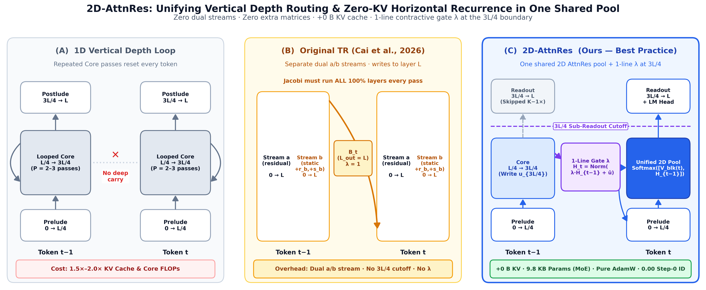
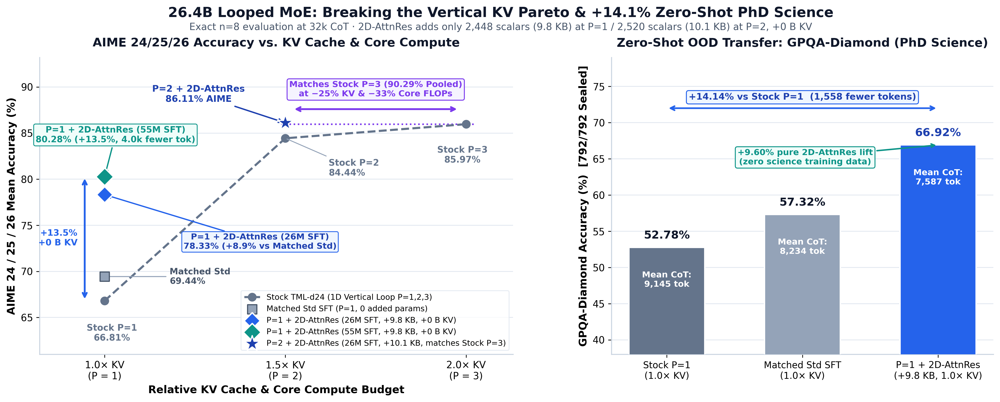
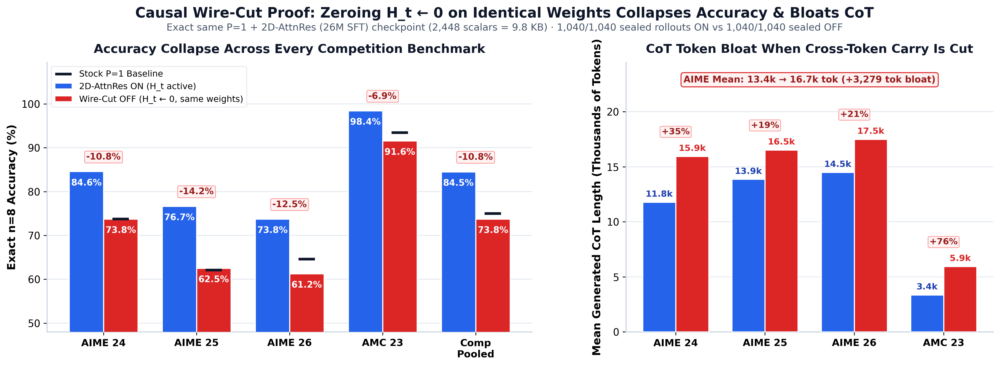
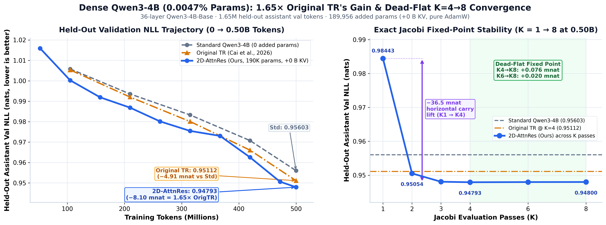
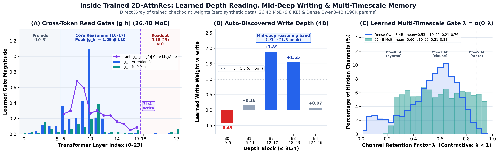

# Loop-2D (`2D-AttnRes`)

**Unifying vertical depth routing and zero-KV horizontal recurrence in one shared Attention Residual pool + a 1-line contractive forgetting gate $\lambda$ at the $3L/4$ boundary.**

> **TL;DR** — Standard Transformers only pass information *horizontally* at the same depth (via KV attention) or *vertically* inside one token (via depth/looping). **`2D-AttnRes`** feeds the previous token's deep hidden state $H_{t-1}$ (captured at $3L/4$ through a 1-line contractive gate $\lambda$) directly into the **same RMSNorm-key softmax residual pool** used across depth — with **`+0 B` KV cache**, **zero extra projection matrices**, **100% standard `AdamW`**, and **exact `0.00e+00` step-0 bit-identity**.

<p align="center">
  
</p>

---

## Key Highlights (All Numbers Disk-Verified)

| Scale & Backbone | Added Params | Extra KV Cache | Optimizer | Headline Verified Result |
| :--- | :---: | :---: | :---: | :--- |
| **26.4B Looped MoE** (`TML-d24`, $P=1$) | **2,448 scalars** (`9.8 KB` fp32, `0.000009%`) | **`+0 B`** (`1.0×`) | Standard `AdamW` | **AIME 24/25/26: `69.44% → 78.33%` (`+8.89%` over Matched Std SFT at 26M tok); `80.28%` (`+13.47%` vs Stock, `4,043` fewer CoT tokens) at 55M tok** |
| **26.4B Looped MoE** (`TML-d24`, $P=1$, **Zero-Shot OOD Science**) | **2,448 scalars** (`9.8 KB` fp32) | **`+0 B`** (`1.0×`) | Standard `AdamW` | **GPQA-Diamond (`792/792`): `52.78% → 66.92%` (`+14.14%` vs Stock, `+9.60%` vs Matched Std, `1,558` fewer tokens)** with **zero science training data** |
| **26.4B Looped MoE** (`TML-d24`, $P=2$) | **2,520 scalars** (`10.1 KB` fp32) | **`+0 B`** (`1.5×`) | Standard `AdamW` | **AIME `86.11%` / Pooled `90.29%`** — **matches `Stock P=3 (85.97% / 90.29%)`** at **`-25%` KV & `-33%` Core FLOPs** |
| **Dense 4B** (`Qwen3-4B-Base`, `0.50B` tokens) | **189,956 params** (`0.0047%`) | **`+0 B`** (`1.0×`) | Standard `AdamW` | **Held-out Val NLL `-8.10 mnat` vs Std (`1.65×` Original TR's `-4.91 mnat`)**, dead-flat `K4→K8: +0.076 mnat` |

---

## Method: One Shared 2D Pool + 1-Line Contractive Gate $\lambda$

Everything in **`2D-AttnRes`** reduces to **two equations** and **exact sub-readout Jacobi parallel training**:

1. **Unified 2D-AttnRes Read (every sublayer $\ell$):**
   Token $t$'s sublayer attends with one shared RMSNorm-key softmax over its vertical depth blocks **and** the previous token's deep carry $H_{t-1}$, gated by a zero-initialized scalar $g_h$:

   $$\mathcal{P}_{\ell}(t) = \big[\,\text{VerticalBlocks}_{\le \ell}(t)\;\cup\;\{H_{t-1}\}\,\big], \qquad \text{AttnRes}_{2\text{D}}\big(q_\ell,\, \mathcal{P}_{\ell}(t),\, g_{h,\ell}\big)$$

   - **Exact `0.00e+00` bit-identity at step 0** when $g_h = 0$, with full $O(1)$ non-vanishing gradients from the very first backward pass.
   - **Mean-centered vertical log-partition** (`center_ref=True`: referencing $z_H$ against $\text{LSE}_v - \log S$) prevents deep vertical blocks from exponentially starving horizontal gate gradients.

2. **1-Line Contractive Write strictly at $L_{\text{out}} = \lfloor 3L/4 \rfloor$:**

   $$H_t = \mathrm{RMSNorm}\!\Big(\sigma(\theta_\lambda) \odot H_{t-1} + \mathrm{RMSNorm}\big(u_{3L/4}(t)\big)\Big)$$

   - **Constant $O(1)$ per-sequence carry (`+0 B` per-token KV cache):** Dense Transformers carry strictly one $D$-vector $H_{t-1}$ across token step $t-1 \to t$. On Looped MoE (`TML-d24`), which already contains a pretrained vertical `MessageGate` inside its Core, Pass 0 additionally feeds token $t-1$'s Core block summary `ws_state` (`2×D`, total `3×D` constant per-sequence state, still strictly `+0 B` KV cache per token) alongside $H_{t-1}$ through the zero-initialized gate `g_h_msg0`. The `--carry-cut` causal diagnostic zeroes the entire cross-token wire (`H_{t-1}` and `ws_state`).
   - **Multi-timescale contraction:** $\sigma(\theta_\lambda) \in (0, 1)^D$ (initialized uniformly across $[0.25, 0.95]$) enforces bounded spectral radius, eliminating train–test fixed-point drift across unbounded autoregressive rollouts ($K=4 \to K=8 \to K=\infty$).
   - **Exact sub-readout Jacobi acceleration:** Because layers $> 3L/4$ perform pure vocabulary readout and never write to the carry, passes $1 \dots K{-}1$ of parallel Jacobi training stop strictly at $3L/4$ — skipping the top $L/4$ layers and vocabulary LM head with **zero approximation error**.

### Core PyTorch Recipe (See [`loop2d/pool.py`](loop2d/pool.py))

```python
# 1. Unified 2D-AttnRes Read (inside each sublayer, zero-init g_h -> exact 0.0 step-0 identity)
h_in = attnres_2d_pool(q, vertical_blocks, h_carry=H_prev, gamma_h=g_h, center_ref=True)

# 2. 1-Line Contractive Write strictly at layer 3L/4 (+0 B KV, zero extra matrices, pure AdamW)
H_next = rmsnorm_unweighted(torch.sigmoid(theta_lambda) * H_prev + rmsnorm_unweighted(u_3l4))
```

### Why `2D-AttnRes` vs. Original TR & 1D Vertical Loops

| Property | 1D Vertical Loop (`TML-d24 P=2/3`) | Original TR (Cai et al., 2026) | **`2D-AttnRes` (Ours)** |
| :--- | :---: | :---: | :---: |
| **Cross-token deep-to-shallow carry** | No (resets each token) | Yes (dual `a/b` streams) | **Yes (unified 2D softmax pool)** |
| **Extra KV cache cost** | `+50%` to `+100%` (`1.5×–2.0×`) | `+0 B` (`1.0×`) | **`+0 B` (`1.0×`)** |
| **Separate dual residual stream (`r_a/r_b/s_b/dB`)** | No | Yes (all $2L$ sublayers) | **No (eliminated — one shared pool)** |
| **Write boundary ($L_{\text{out}}$)** | N/A | $L$ (vocabulary readout interference) | **$3L/4$ (clean reasoning-to-readout split)** |
| **Jacobi passes $1 \dots K{-}1$ compute** | N/A | `100%` of layers | **`75%` of layers (exact — zero error)** |
| **Contractive multi-timescale forgetting ($\lambda$)** | No | No ($\lambda = 1$) | **Yes ($\sigma(\theta_\lambda) \in (0, 1)^D$)** |
| **Dense 4B gain over Std (`0.50B` val NLL)** | N/A | `-4.91 mnat` | **`-8.10 mnat` (`1.65×` Original TR)** |

---

## Experimental Results

### 1. 26.4B Looped MoE (`TML-d24-varloop`): KV/Compute Pareto & Zero-Shot OOD Science

All evaluations use exact autoregressive decoding (`n=8` samples/problem on competition math = `1,040` rollouts; `n=2` on MATH-500 = `1,000` rollouts; `n=4` on GPQA-Diamond = `792` rollouts) at `32,768` max tokens (`T=1.0, top_p=0.95`). Two math SFT splits are evaluated: **`26M SFT`** (`26M` reasoning tokens, with matched `Std SFT` control) and **`55M SFT`** (`55M` expanded reasoning tokens).

<p align="center">
  
</p>

| Model Configuration (`TML-d24`, 26.4B MoE) | Added Params | KV Cache | AIME 24 | AIME 25 | AIME 26 | **AIME Mean** | AMC 23 | **Comp Pooled** | MATH-500 | **GPQA-Diamond** *(Zero-Shot OOD)* | Mean AIME Tok |
| :--- | :---: | :---: | :---: | :---: | :---: | :---: | :---: | :---: | :---: | :---: | :---: |
| `Stock P=1` | `0` | `1.0×` | 73.75 | 62.08 | 64.58 | **66.81%** | 93.44 | **75.00%** | 96.30 | **52.78%** *(9,145t)* | 16,565 |
| `Matched Std SFT (P=1, 26M SFT)` | `0` | `1.0×` | 75.83 | 63.75 | 68.75 | **69.44%** | 95.94 | **77.60%** | 96.60 | **57.32%** *(8,234t)* | 14,802 |
| **`P=1 + 2D-AttnRes` (`26M SFT`)** | **`2,448` (`9.8 KB`)** | **`1.0×`** | **84.58** | **76.67** | **73.75** | **78.33%** | **98.44** | **84.52%** | **97.70** | **66.92%** *(7,587t)* | **13,385** |
| **`P=1 + 2D-AttnRes` (`55M SFT`)** | **`2,448` (`9.8 KB`)** | **`1.0×`** | **85.00** | **79.17** | **76.67** | **80.28%** | **98.44** | **85.87%** | **98.56*** | — | **12,522** |
| `Stock P=2` | `0` | `1.5×` | 90.83 | 81.67 | 80.83 | **84.44%** | 99.38 | **89.04%** | 98.30 | — | 12,038 |
| **`P=2 + 2D-AttnRes` (`26M SFT`)** | **`2,520` (`10.1 KB`)** | **`1.5×`** | **88.75** | **85.83** | **83.75** | **86.11%** | **99.69** | **90.29%** | **98.97*** | — | **11,494** |
| `Stock P=3` | `0` | `2.0×` | 92.92 | 83.75 | 81.25 | **85.97%** | 100.00 | **90.29%** | 98.30 | — | 11,291 |

*\*`MATH-500` on `P=1 (55M SFT)` and `P=2 (26M SFT)` reflect 971/1,000 completed rollouts across 7/8 finished ranks at snapshot time; all competition (`1,040/1,040`), `P=1 (26M SFT)` MATH-500 (`1,000/1,000`), and GPQA-Diamond (`792/792`) numbers are 100% sealed.*

- **Zero-shot PhD Science generalization (GPQA-Diamond):** Trained **strictly on math trajectories** (`26M SFT`) with zero science data, `P=1 + 2D-AttnRes` improves **`+14.14%` over Stock `P=1`** and **`+9.60%` over Matched Std SFT** while generating **`1,558` fewer CoT tokens** (`9,145 → 7,587`).
- **Pareto dominance at `P=2`:** Adding `10.1 KB` (`2,520` scalars) lets `P=2 + 2D-AttnRes` **surpass `Stock P=3` on AIME (`86.11%` vs `85.97%`)** and **match `Stock P=3` on Pooled Competition (`90.29%` vs `90.29%`)** at **`-25%` KV cache and `-33%` Core FLOPs**.

---

### 2. Causal Wire-Cut Proof (`--carry-cut`: $H_t \leftarrow 0$ on Identical Weights)

Is the gain coming from SFT data exposure or genuinely from the cross-token `2D-AttnRes` latent wire? Evaluating the **exact same trained `P=1 + 2D-AttnRes (26M SFT)` checkpoint** with `--carry-cut` (zeroing the cross-token carry) isolates the causal effect directly:

<p align="center">
  
</p>

| Exact Same `P=1 + 2D-AttnRes (26M SFT)` Weights | AIME 24 | AIME 25 | AIME 26 | **AIME Mean** | AMC 23 | **Comp Pooled** | Mean AIME Length |
| :--- | :---: | :---: | :---: | :---: | :---: | :---: | :---: |
| **`2D-AttnRes` ON** (carry active, `1,040/1,040`) | 84.58% | 76.67% | 73.75% | **78.33%** | 98.44% | **84.52%** | `13,385 tok` |
| **Wire-Cut OFF** (`--carry-cut`, carry ← 0, `1,040/1,040`) | 73.75% | 62.50% | 61.25% | **65.83%** | 91.56% | **73.75%** | `16,664 tok` |
| **Causal Effect of Cutting Carry** | **−10.83%** | **−14.17%** | **−12.50%** | **−12.50%** | **−6.88%** | **−10.77%** | **`+3,279 tok` (+24.5%)** |

Severing the `9.8 KB` cross-token carry collapses performance **below `Stock P=1` (`75.00%`)** and forces the model to generate **`+3,279` additional CoT tokens** trying to re-externalize reasoning into text.

---

### 3. Dense `Qwen3-4B-Base` (`0.50B` Tokens): `1.65×` Original TR & Dead-Flat $K=4\to 8$ Stability

On a standard non-looped 36-layer dense Transformer (`Qwen3-4B-Base`, `1.65M` held-out assistant validation tokens, `0.50B` training tokens), `2D-AttnRes` adds `189,956` parameters (`0.0047%` of 4.02B, `+0 B` KV, pure `AdamW`):

<p align="center">
  
</p>

| Method (`Qwen3-4B-Base`, `0.50B` Tokens) | Added Params | Val NLL (`s400`) | Val NLL (`s800`) | Val NLL (`s1200`) | Val NLL (`s1600`) | **Final NLL (`s1907`)** | **$\Delta$ vs Std** | **$K8 - K4$ Drift** |
| :--- | :---: | :---: | :---: | :---: | :---: | :---: | :---: | :---: |
| `Standard Qwen3-4B` | `0` | 1.00582 | 0.99356 | 0.98330 | 0.97075 | **0.95603** | `0.00 mnat` | — |
| `Original TR` (Cai et al., 2026) | `2,776` | 1.00535 | 0.99205 | 0.98008 | 0.96606 | **0.95112** | `−4.91 mnat` | `+0.029 mnat` |
| **`2D-AttnRes` (Ours)** | **`189,956` (`0.0047%`)** | **1.00026** | **0.98686** | **0.97547** | **0.96255** | **0.94793** | **`−8.10 mnat` (`1.65×`)** | **`+0.076 mnat`** |

Exact `K1 → K8` fixed-point trajectory at `0.50B`: `K1=0.98443 → K2=0.95054 → K3=0.94808 → K4=0.94793 → K6=0.94798 → K8=0.94800` (**`−36.5 mnat`** cross-token lift; **`+0.020 mnat`** from `K6` to `K8`).

---

### 4. Mechanistic X-Ray: Inside Trained `2D-AttnRes` Checkpoints

Inspecting the actual trained weights reveals three clear structural properties across both architectures:

<p align="center">
  
</p>

1. **Core-focused reading, readout-zone silence (Panel A):** On 26.4B MoE, learned cross-token gates $|g_h|$ surge in the reasoning Core (`L6–L12`, peak `1.09` at Layer 10, `|tanh(g_h_msg0)| = 0.68` at Layer 8) and drop to `~0.01` across the Postlude vocabulary readout (`L18–L23`).
2. **Autonomous mid-deep write discovery (Panel B):** On 36-layer Dense `Qwen3-4B`, `w_write` (initialized uniformly at `1.0` across the 5 depth blocks $\le 3L/4$) suppresses shallow lexical embeddings (`-0.43` on `L0–5`) and concentrates writes in the **mid-deep reasoning band (`+1.89` on `L12–17`, `+1.55` on `L18–23`)**.
3. **Multi-timescale contractive spectrum (Panel C):** Initialized uniformly across $[0.25, 0.95]$, $\lambda = \sigma(\theta_\lambda)$ retains a broad multi-timescale spectrum on short MoE runs (`mean=0.60, p10–90=0.31–0.88`, half-lives `0.5–5.4` tokens) and adapts over `0.50B` dense 4B training into a peaked reasoning-horizon distribution (`mean=0.53, p10–90=0.21–0.76`).

---

## Quickstart & Usage

### Install Dependencies

```bash
pip install -r requirements.txt
pip install -e .  # optional editable install
```

### 1. Run Self-Contained Verification & Unit Tests (CPU, `<10s`)

Verifies step-0 `0.00e+00` bit-identity, `O(1)` step-0 gradient flow, exact `K=T` Jacobi parallel vs. token-by-token sequential parity (`<1e-4`), zero cross-document carry bleed, `--carry-cut` behavior, and exact production parameter counts (`2,448` / `2,520` / `189,956`):

```bash
PYTHONPATH=. pytest -v tests/test_2d_attnres.py
PYTHONPATH=. python3 examples/quickstart_2d_attnres.py
```

### 2. Train `2D-AttnRes` (Standard `AdamW`, Exact Sub-Readout Jacobi)

Training scripts read memory-mapped packed NumPy arrays (`{split}_ids.npy`, `{split}_labels.npy` with `-100` mask on prompt tokens, and `{split}_docstarts.npy` boolean document-start mask) from `--data-dir`.

**Dense Transformer (`Qwen3-4B-Base`, multi-GPU DDP):**

```bash
PYTHONPATH=. torchrun --nproc_per_node=8 scripts/train_dense.py \
  --model Qwen/Qwen3-4B-Base \
  --data-dir /path/to/packed_sft_data \
  --out-dir runs/qwen3_4b_2d_attnres \
  --mode attnres_2d --attn-impl flash_attention_2 \
  --passes 4 --backprop-last 2 \
  --total-tokens 500000000
```

**26.4B Looped MoE (`TML-d24-varloop`, single-root FSDP2):**

```bash
PYTHONPATH=. torchrun --nproc_per_node=8 scripts/train_looped_moe.py \
  --model /path/to/tml_d24_bf16 \
  --data-dir /path/to/packed_math_data \
  --out-dir runs/tml_d24_p1_2d_attnres \
  --mode attnres_2d --loop-passes 1 \
  --passes 4 --backprop-last 2
```

### 3. Exact Autoregressive Evaluation & Causal Wire-Cut (`--carry-cut`)

```bash
# Competition math (n=8 samples/problem = 1,040 rollouts)
PYTHONPATH=. python3 scripts/eval_looped_moe.py \
  --ckpt runs/tml_d24_p1_2d_attnres/ckpt_final \
  --bench-dir /path/to/benchmarks \
  --mode attnres_2d --loop-passes 1 --samples-per-prob 8 \
  --benchmarks aime24,aime25,aime26,amc23 \
  --out-dir evals/p1_2d_attnres_comp

# MATH-500 (n=2 = 1,000 rollouts) & Zero-Shot OOD GPQA-Diamond (n=4 = 792 rollouts)
PYTHONPATH=. python3 scripts/eval_looped_moe.py \
  --ckpt runs/tml_d24_p1_2d_attnres/ckpt_final \
  --bench-dir /path/to/benchmarks --gpqa-path /path/to/gpqa_diamond.jsonl \
  --mode attnres_2d --loop-passes 1 --samples-per-prob 4 \
  --benchmarks gpqa_diamond --out-dir evals/p1_2d_attnres_gpqa

# Causal wire-cut ablation on the EXACT same checkpoint (add --carry-cut)
PYTHONPATH=. python3 scripts/eval_looped_moe.py \
  --ckpt runs/tml_d24_p1_2d_attnres/ckpt_final \
  --bench-dir /path/to/benchmarks \
  --mode attnres_2d --loop-passes 1 --samples-per-prob 8 --carry-cut \
  --benchmarks aime24,aime25,aime26,amc23 \
  --out-dir evals/p1_2d_attnres_cut

# Problem-paired Delta +/- SE and z-score aggregation
PYTHONPATH=. python3 scripts/score_eval.py \
  --arms stock=evals/stock_p1 ours=evals/p1_2d_attnres_comp cut=evals/p1_2d_attnres_cut \
  --ref stock
```

### 4. Reproduce All 5 Publication Figures

```bash
python3 scripts/generate_figures.py --out-dir assets
```

---

## Repository Structure

```text
├── loop2d/
│   ├── __init__.py              # Public API exports
│   ├── pool.py                  # Core 2D-AttnRes unified pool + 1-line contractive gate λ
│   ├── dense_qwen3.py           # AttnRes2DDense wrapper for dense Transformers (e.g. Qwen3-4B)
│   └── looped_moe.py            # AttnRes2DLoopedMoE standalone 26.4B Looped MoE + exact cache
├── scripts/
│   ├── train_dense.py           # Multi-GPU DDP Jacobi SFT trainer (pure AdamW)
│   ├── train_looped_moe.py      # Single-root FSDP2 Jacobi trainer for 26.4B MoE (pure AdamW)
│   ├── eval_dense_math.py       # Exact FlashDecoding math evaluator (+ --carry-cut)
│   ├── eval_looped_moe.py       # Exact 32k math & GPQA-Diamond evaluator (+ --carry-cut)
│   ├── score_eval.py            # Multi-rank shard aggregator + paired Delta +/- SE & z-score
│   └── generate_figures.py      # Standalone 300-DPI figure generator for all 5 figures
├── examples/
│   └── quickstart_2d_attnres.py # Self-contained <5s CPU/GPU invariant walkthrough
├── tests/
│   └── test_2d_attnres.py       # Complete unit test suite (identity, parity, isolation, counts)
├── assets/
│   ├── fig1_2d_attnres_architecture.png
│   ├── fig2_moe_pareto_and_ood.png
│   ├── fig3_causal_wire_cut.png
│   ├── fig4_dense_4b_scaling.png
│   └── fig5_mechanistic_anatomy.png
├── pyproject.toml
├── requirements.txt
└── LICENSE
```

---

## Limitations & Scope

- The `55M SFT` row (`80.28%` AIME at `P=1`) does not have a separate matched `Std SFT` control; controlled architectural attribution is established via `Matched Std SFT` on `26M SFT` (`+8.89%` AIME, `+9.60%` GPQA-Diamond) and the causal `--carry-cut` wire-cut on identical weights (`-12.50%` AIME).
- `MATH-500` scores for `P=1 (55M SFT)` and `P=2 (26M SFT)` reflect `971/1,000` rollouts (`7/8` ranks) at release snapshot; all competition math, `P=1 (26M SFT)` MATH-500, and GPQA-Diamond results are 100% sealed.

## Acknowledgments

Built on top of and inspired by **Thinking Machines Lab's `TML-d24-varloop-research`** (Looped MoE + Block/Message Attention Residuals), **Temporal Residuals** (Cai et al., 2026), and **Qwen3-4B-Base**.

## License

Apache License 2.0 — see [`LICENSE`](LICENSE).
